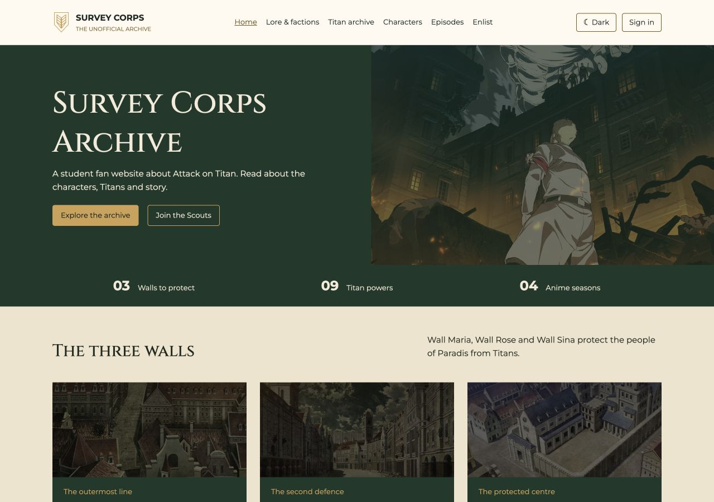
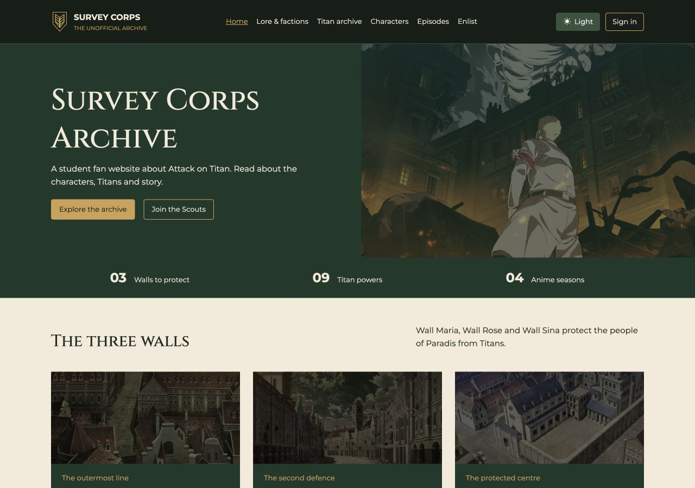
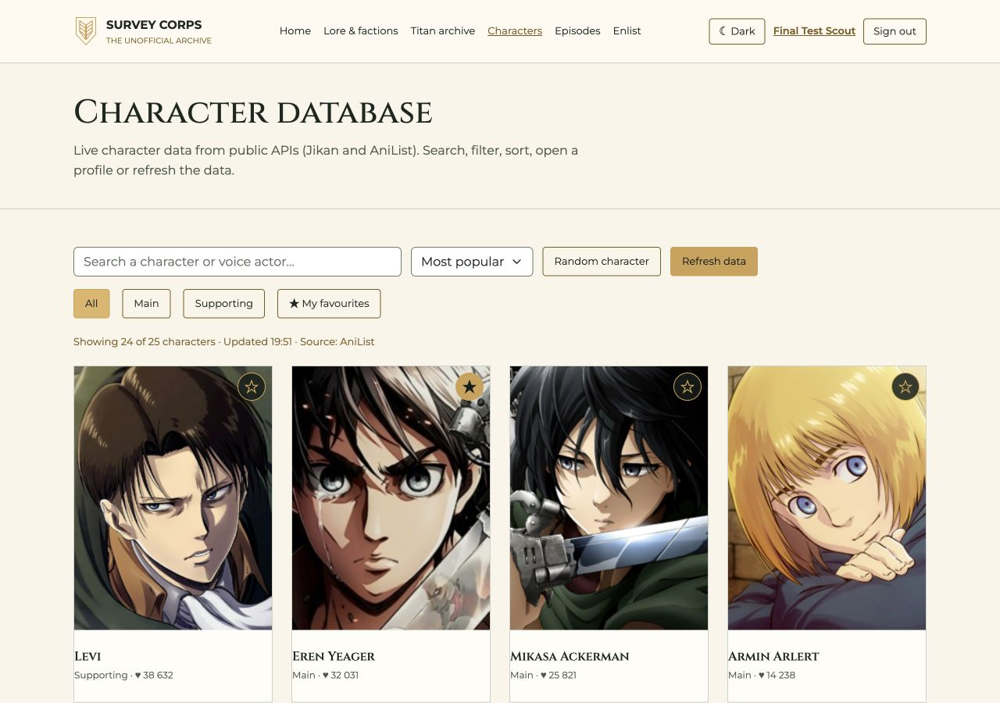
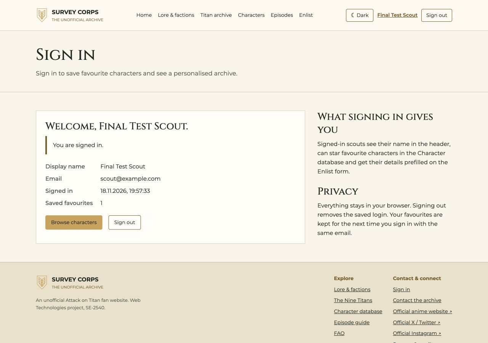
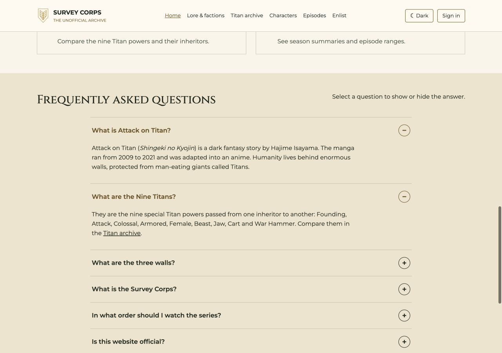
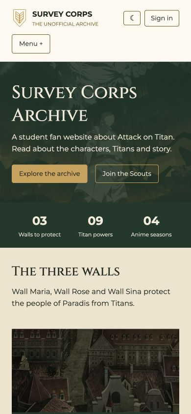

# Survey Corps Archive Final Project Report

**Course:** Web Technologies Final project  
**Group:** SE-2540  
**Team:** Assem Tugelbay, Zhansaya Boranbaikyzy, Alina Ibadulla

## Objective and website structure

Survey Corps Archive is an unofficial Attack on Titan fan website. It continues our midterm and
endterm topic and combines story information with interactive front-end features.

The website has seven pages. Home introduces the walls and characters and includes the FAQ.
Lore explains the story and military branches. Titan archive contains an editable comparison table
and battle gallery. Characters retrieves live data from public APIs. Episodes provides a season guide.
Sign in and Enlist demonstrate validated forms. Shared navigation connects the pages.

## Final requirements and implementation

| Requirement | Implementation |
| --- | --- |
| HTML and CSS | Semantic HTML, external styles, local images and fonts, Flexbox/Grid and responsive layouts |
| Theme toggle | A light/dark control on every page; `sca-theme` is saved in `localStorage` and restored before the page is drawn |
| Sign-in | Validation for name, email and password; only a non-sensitive demo profile is saved under `sca-user` |
| Persistent interface | The profile and account controls remain after reload; sign-out removes the saved profile |
| jQuery FAQ | Seven topic-related questions with `.slideToggle()` animation, `aria-expanded` and +/− indicators |
| Public API | `fetch()` requests JSON from Jikan and AniList; the first valid response is normalized and displayed |
| API interaction | Search, role filters, sorting, profiles, refresh and favourites |
| API errors | HTTP/network/time-out handling, retry, a ten-minute cache and an explicitly labelled offline list |

The previous table CRUD, search, image viewer and recruit-card form are retained.
Sign-in is a browser-only demonstration; it does not verify a real account or provide server security.
Passwords and messages are not stored or sent. The recruit-card download contains only the name and regiment.

## Development and code organization

The Final update keeps the existing website and separates the shared JavaScript into smaller files.
`init.js` restores preferences before CSS loads. `script.js` provides storage helpers, theme controls,
mobile navigation and the shared image viewer. `account.js` handles the profile, forms and FAQ.
`titans.js` handles table records. `characters.js` processes API responses and displays the catalogue.
This organization makes each part easier to review and demonstrate without adding a build system.

The saved API response is checked before use. A damaged cache is ignored so that the page can request
valid data. An expired but valid cache triggers a refresh and can be reused with a notice if the APIs fail.
The name displayed in the header now links to the account page, which remains reachable after sign-in.

## Individual responsibilities

| Member | GitHub | Final responsibility and explanation |
| --- | --- | --- |
| Assem Tugelbay | `asemtygelbaeva-byte` | Theme persistence, shared layout/navigation, startup script, responsive checks and integration |
| Zhansaya Boranbaikyzy | `zhansayaboranbaykyzy07-code` | Public API and JSON processing, catalogue search/filters, cache validation, Titan records and error states |
| Alina Ibadulla | `alina7-p` | Sign-in/out and profile persistence, input validation, registration and jQuery FAQ |

## Verification

The theme was checked after reload and across all seven pages. Sign-in validation, persistent profile,
account navigation and sign-out were exercised in the browser. All seven FAQ questions were opened
and closed. Live AniList data was retrieved and used for case-insensitive search, role filtering,
profile display and pagination. A regression check covers valid cache data, damaged records,
invalid timestamps, malformed JSON and API response normalization. Favourite persistence, registration,
Titan CRUD, delete confirmation and gallery navigation were also checked. All seven pages fit at
1280px, 768px and 390px without page-level horizontal overflow.

## Screenshots

## Presentation plan

| Time | Speaker | Demonstration |
| --- | --- | --- |
| 0:00–1:00 | Assem | Project idea, pages, shared navigation and persistent theme |
| 1:00–2:00 | Zhansaya | Character API, JSON, filters, error handling and Titan table |
| 2:00–3:00 | Alina | Sign-in/out, storage, validation and FAQ |

The remaining three minutes are for individual questions, one minute per student.

## Links, sources and AI use

- Repository: https://github.com/asemtygelbaeva-byte/survey-corps-archive
- Website: https://asemtygelbaeva-byte.github.io/survey-corps-archive/
- Image credits and licences: [ASSET_SOURCES.md](ASSET_SOURCES.md)
- API documentation: [Jikan](https://docs.api.jikan.moe/) and [AniList](https://docs.anilist.co/)

AI Tools Acknowledgment:
AI assistants were used as supporting tools for code debugging, brainstorming FAQ questions, and reviewing JavaScript syntax. All final code implementation, integration, and design choices were reviewed and verified by the project group members.
