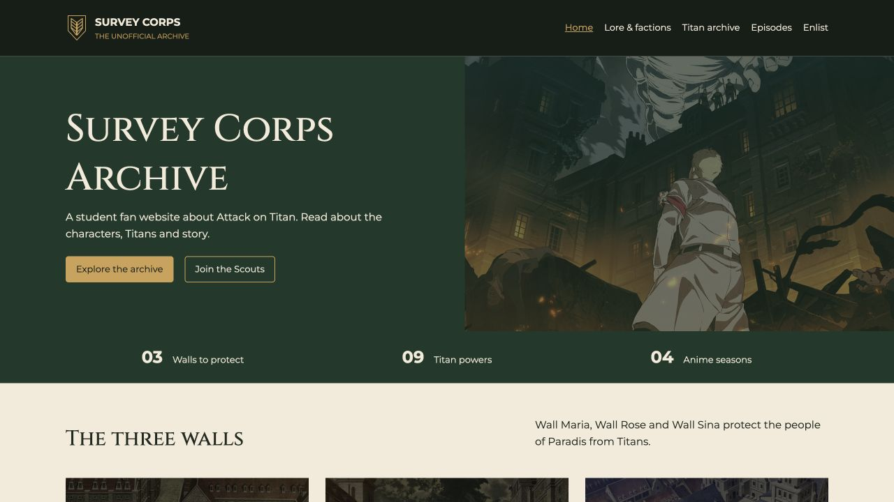
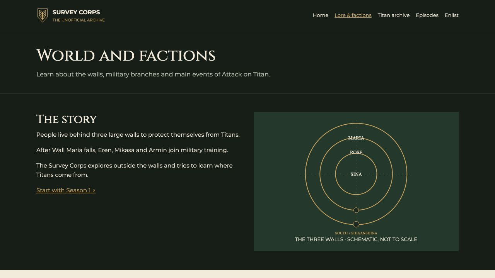
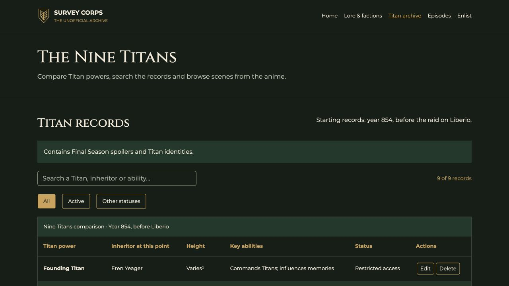
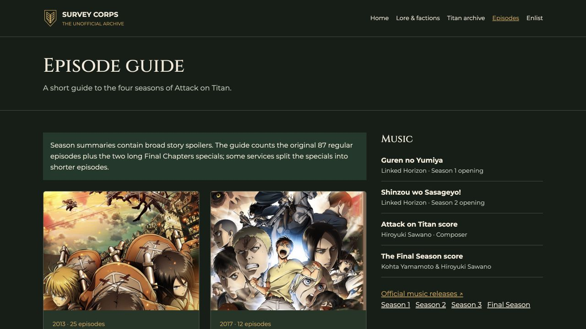
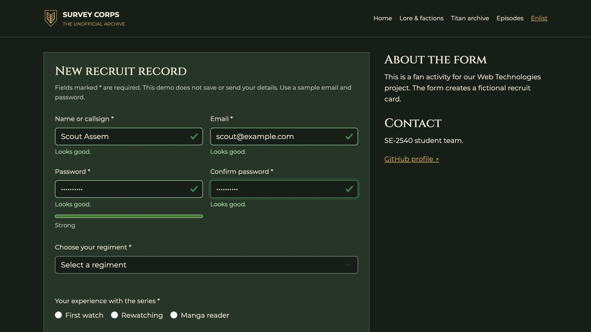
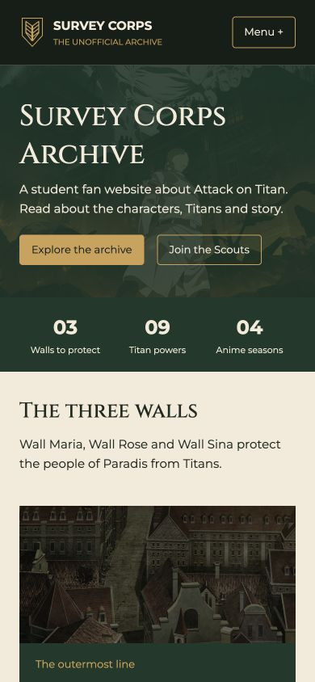

# Survey Corps Archive

A fan website about **Attack on Titan**, made for the Web Technologies endterm project.
It continues our midterm project with the same topic and five pages.

**Group:** SE-2540  
**Team:** Assem Tugelbay, Zhansaya Boranbaikyzy, Alina Ibadulla

- **Website:** [Open Survey Corps Archive](https://asemtygelbaeva-byte.github.io/survey-corps-archive/)
- **Repository:** [View the source code](https://github.com/asemtygelbaeva-byte/survey-corps-archive)

## Pages

| Page | What it includes |
| --- | --- |
| [Home](index.html) | The three walls, main characters and links to the other pages |
| [Lore and factions](about.html) | Story introduction, wall diagram, military branches and commanders |
| [Titan archive](titans.html) | Searchable Titan table, status filters, record editing and battle gallery |
| [Episode guide](episodes.html) | Four season cards, expandable episode guides and music information |
| [Enlistment](join.html) | Registration form and a downloadable fictional recruit card |

## What we added for the endterm

- **Form validation:** required fields, email check with RegEx, password confirmation and live feedback.
- **Password strength:** a meter showing weak, medium or strong passwords.
- **Search and filters:** results update as you type; status buttons work together with the search.
- **CRUD table:** add, view, edit and delete Titan records, with confirmation before deletion.
- **Image gallery:** enlarged images, Previous/Next buttons, keyboard arrows and jQuery fade effects.
- **Simpler CSS:** shared styles, fewer decorative elements and responsive layouts.

## Screenshots

Desktop previews and a mobile view of the published website.

| Home | Lore and factions |
| --- | --- |
|  |  |

| Titan archive | Episode guide |
| --- | --- |
|  |  |

| Enlistment form | Mobile home page |
| --- | --- |
|  |  |

## How to run

1. Download the repository using **Code → Download ZIP**, or clone it.
2. Extract the files and open `index.html` in a browser.

No installation or build is needed. Bootstrap, jQuery, fonts and images are stored locally.
The published version uses GitHub Pages from the same repository.

## Try the interactive features

- On **Titan archive**, type `Eren` and select **Active** to combine search with a category filter.
- Open **Add or edit a Titan** to add a record. Use **Edit** or **Delete** beside a row to change it.
- Click an image in the battle gallery. Use the arrows to browse and **Escape** to close it.
- On **Enlistment**, fill in the form, check the password feedback and download a recruit card.

Table edits last until the page is reloaded. The form runs in the browser: email addresses,
passwords and messages are not sent or saved. The downloaded card contains only the name
and chosen regiment.

## Technologies and files

HTML5, CSS3, Bootstrap 5, JavaScript and jQuery 3.7.1.

```text
survey-corps-archive/
├── index.html, about.html, titans.html, episodes.html, join.html
├── css/             Shared styles and local fonts
├── js/script.js     Form validation, table, search and gallery
├── assets/          Images, fonts and crest
├── vendor/          Bootstrap and jQuery
└── screenshots/     Desktop and mobile previews
```

## Team responsibilities

| Member | Main area |
| --- | --- |
| Assem Tugelbay | Home page, shared header/footer and CSS |
| Zhansaya Boranbaikyzy | Lore page, Titan table, search and gallery |
| Alina Ibadulla | Episode page, registration form and responsive checks |

## Checks

The five pages were checked at **1280px, 768px and 390px** widths.
Form validation, password feedback, combined search and filters, table operations,
gallery controls, mobile menu, local links and assets were tested.

## Credits

See [ASSET_SOURCES.md](ASSET_SOURCES.md) for image credits and references.
Attack on Titan belongs to its original rights holders. This is an unofficial student fan project.
Bootstrap and jQuery use the MIT license; the local fonts include their OFL license files.
