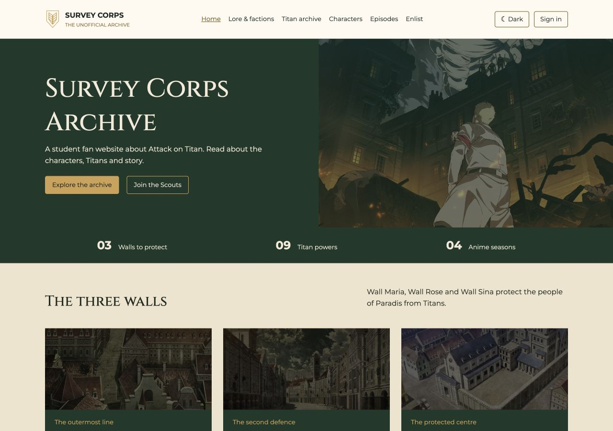
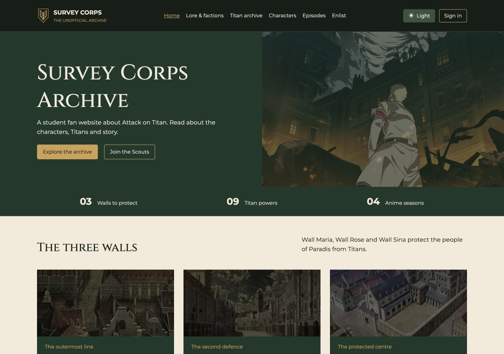
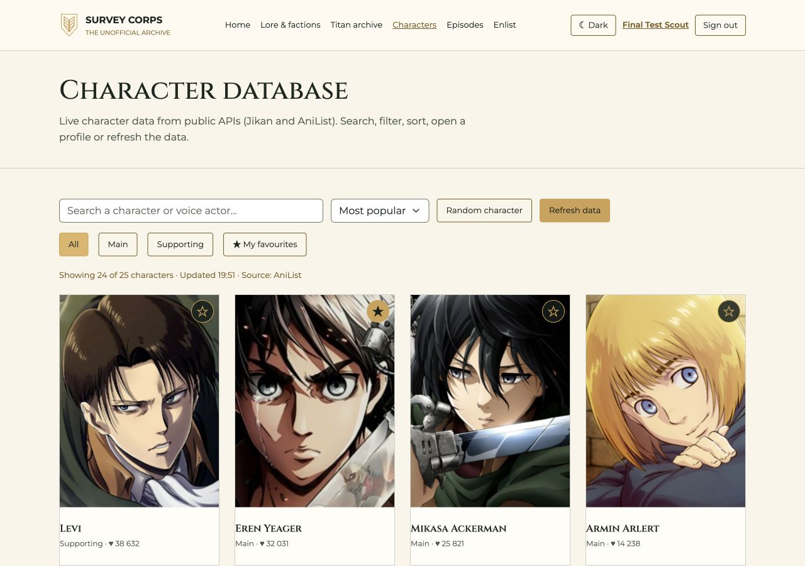
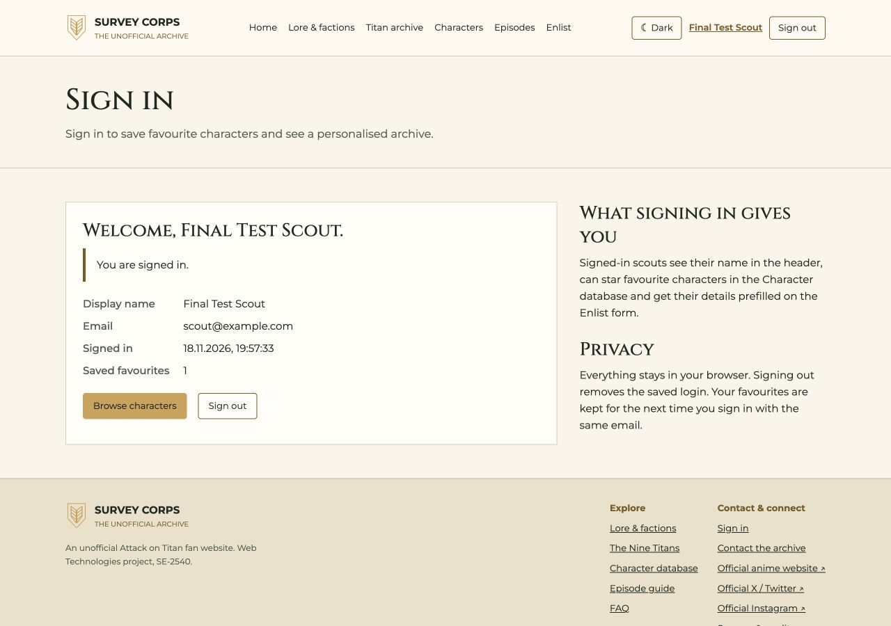
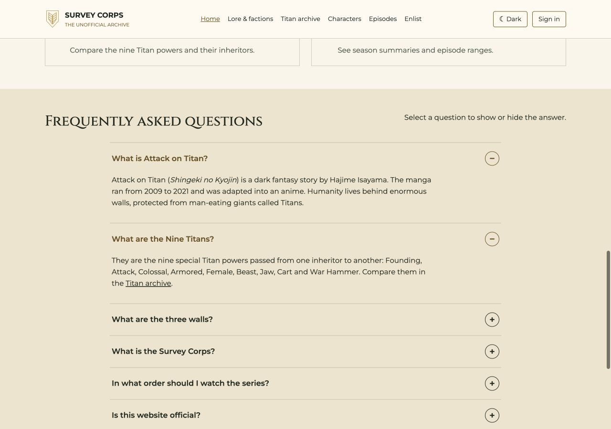
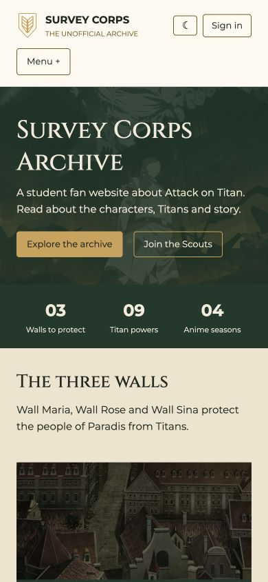

# Survey Corps Archive

An unofficial **Attack on Titan** fan website for the Web Technologies Final project.
**Group:** SE-2540. **Team:** Assem Tugelbay, Zhansaya Boranbaikyzy and Alina Ibadulla.

[Open the website](https://asemtygelbaeva-byte.github.io/survey-corps-archive/) · [GitHub repository](https://github.com/asemtygelbaeva-byte/survey-corps-archive) · [Group report](PROJECT_REPORT.md)

## Pages

Home, Lore, Titan archive, Characters, Episodes, Sign in and Enlist.
All seven pages share the same navigation, theme and account controls.

## Final features

- Light/dark theme saved in `localStorage` and restored on every page.
- Validated demo sign-in, persistent profile and sign-out. Passwords are never saved.
- Seven-question FAQ using jQuery `.slideToggle()` and +/− indicators.
- Character data loaded with `fetch()` from Jikan or AniList as JSON.
- Character search, role filters, profiles, refresh, favourites and clear API error states.
- A ten-minute API cache, an offline fallback and validation of damaged cached data.
- Editable Titan table with search, filters, confirmation before deletion and local persistence.
- Image gallery and a validated enlistment form with a downloadable fan card.

## Team responsibilities

| Member and GitHub | Final part | Main files |
| --- | --- | --- |
| Assem — [asemtygelbaeva-byte](https://github.com/asemtygelbaeva-byte) | Theme, shared layout, navigation and integration | `js/init.js`, `js/script.js`, shared HTML and CSS |
| Alina — [alina7-p](https://github.com/alina7-p) | Sign-in/out, registration form and FAQ | `js/account.js`, `signin.html`, `join.html`, FAQ in `index.html` |
| Zhansaya — [zhansayaboranbaykyzy07-code](https://github.com/zhansayaboranbaykyzy07-code) | Character API, search, filters and Titan records | `js/characters.js`, `js/titans.js`, `characters.html`, `titans.html` |

## Run locally

Download the repository, extract it and open `index.html`. No installation or build is needed.
Internet is needed for live character data. A small offline list is shown if the APIs fail.

Sign-in is a front-end demonstration, not real authentication. Only the display name,
email and sign-in time are kept in the browser; passwords are checked and discarded.
Do not use real passwords. Titan edits and preferences are stored on this device.

## Screenshots

| Light theme | Dark theme |
| --- | --- |
|  |  |

| Character API | Saved sign-in |
| --- | --- |
|  |  |

| jQuery FAQ | Mobile view |
| --- | --- |
|  |  |

## Code structure

`init.js` restores preferences before the styles load. Deferred scripts then load in order:
`script.js` for shared helpers and interface, `account.js` for account/forms/FAQ,
and `titans.js` for the table. The Characters page also loads its fallback list and API script.
The project uses HTML5, CSS3, Bootstrap 5, JavaScript and jQuery 3.7.1.

## Credits and AI use

Image credits and font licences are listed in [ASSET_SOURCES.md](ASSET_SOURCES.md).
Character data comes from [Jikan](https://jikan.moe/) and [AniList](https://anilist.co/).
The series and artwork belong to their original rights holders.

AI tools, including OpenAI Codex, assisted with JavaScript organization, API error handling,
testing and documentation. 
